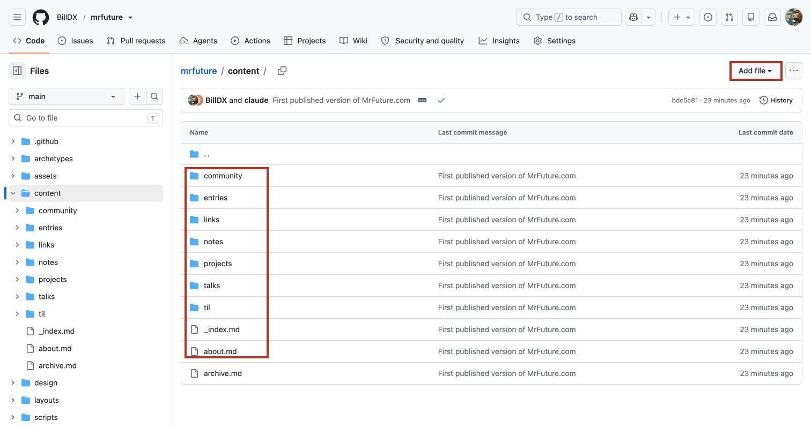
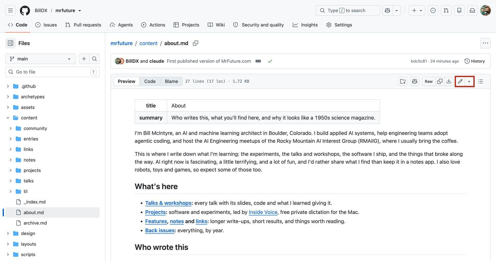
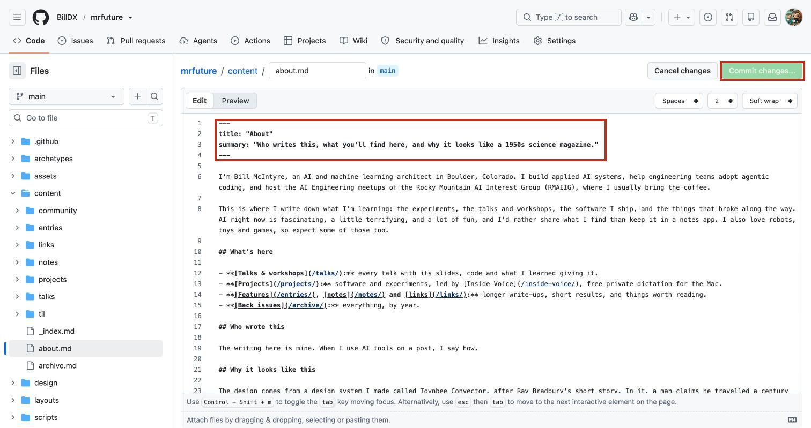
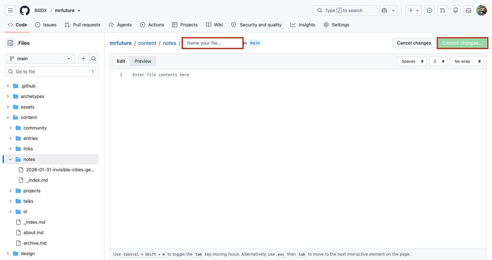
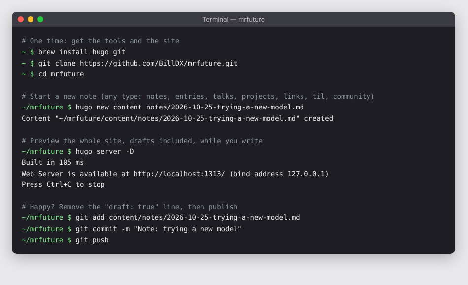
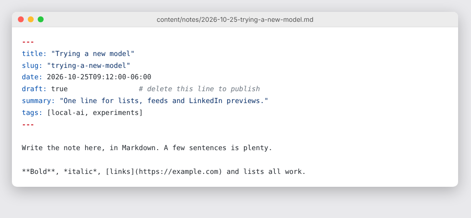
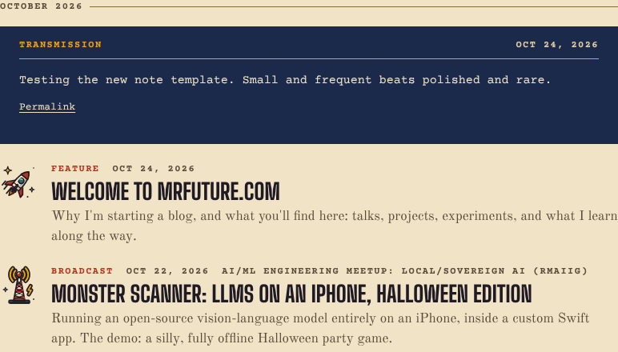
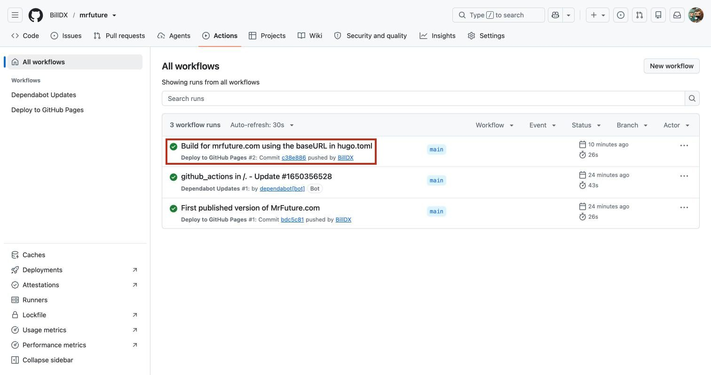
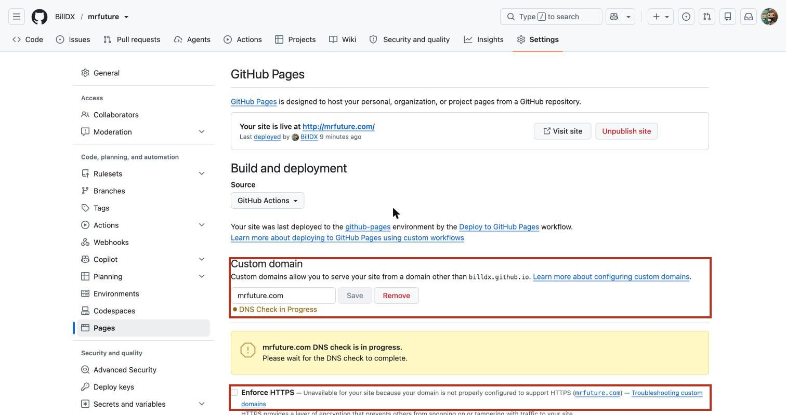

# How to post to and run MrFuture.com

A quick guide for Bill. Everything on the site is a plain Markdown file in this repo. When a change lands on the `main` branch, GitHub builds the site with Hugo and publishes it to mrfuture.com, usually within a minute.

```
You edit a .md file  →  commit to main  →  GitHub Actions builds it  →  live on mrfuture.com
```

There are two ways to post:

| | Way 1: on github.com | Way 2: on your Mac |
|---|---|---|
| Best for | Fixing a typo, a short note or link | Longer posts, images, anything you want to preview first |
| Needs | A browser | Hugo and Git (`brew install hugo git`) |
| Preview before publishing | GitHub's Markdown preview only | The whole site, exactly as it will look |

---

## Where things live

All posts are in `content/`, one folder per kind of post:



| Folder | What goes in it | Shows on the site as | Address |
|---|---|---|---|
| `notes` | A short thought or result (LinkedIn-sized) | Transmission | `/2026/10/slug/` |
| `links` | Someone else's article plus your take | Recommended reading | `/2026/10/slug/` |
| `entries` | A full write-up | Feature | `/2026/10/slug/` |
| `talks` | One page per talk, workshop or panel | Broadcast | `/talks/slug/` |
| `projects` | One page per project | Invention | `/projects/slug/` |
| `til` | A small "today I learned" | Service bulletin | `/til/slug/` |
| `community` | A meetup or event you hosted | Community | `/community/slug/` |

`about.md` is the About page. The Inside Voice page is `projects/inside-voice.md`.

**Name files with the date first**, like `2026-10-25-trying-a-new-model.md`, so they sort in order. The address uses the `slug:` line, not the file name.

---

## Way 1: post or edit on github.com

### Edit an existing page

1. Open the file on GitHub (for example `content/about.md`) and click the **pencil** icon.

   

2. Edit the text. The block between the two `---` lines at the top is the page's settings (title, summary, tags…). Everything below it is the post, in Markdown.

   

3. Click **Commit changes…**, write a short message (like "Fix typo in About"), leave **Commit directly to the main branch** selected, and click **Commit changes**. That's it: the site updates in about a minute.

### Write a new post

1. Go to the folder for the kind of post (for example `content/notes`), click **Add file → Create new file**.
2. Type the file name (like `2026-10-25-trying-a-new-model.md`), then paste in the template below and write.

   

3. Commit it, as above.

**Template to paste** (change the parts in quotes):

```yaml
---
title: "Trying a new model"
slug: "trying-a-new-model"
date: 2026-10-25T09:00:00-06:00
summary: "One line for lists, feeds and LinkedIn previews."
tags: [local-ai, experiments]
---

Write the post here, in Markdown.
```

For a **talk**, add these lines inside the `---` block too:

```yaml
event: "AI/ML Engineering meetup (RMAIIG)"
location: "Founder Central, Boulder, Colorado"
role: speaker          # speaker | workshop | panelist | host | organizer | mentor
slides: "https://billdx.github.io/your-deck/"
repo: "https://github.com/BillDX/your-repo"
video: ""
```

For a **project**: `status: shipped` (or `active`, `paused`, `archived`), `repo:`, `download:`. For a **link**: `link_url: "https://…"`.

---

## Way 2: write on your Mac, preview, then publish

One-time setup, then the same three steps each time:



1. **Create the post.** `hugo new content notes/2026-10-25-trying-a-new-model.md` makes the file with the right fields filled in, the title and slug taken from the file name, and `draft: true`. Use `entries/`, `talks/`, `links/` and so on for other kinds.

   

2. **Preview.** Run `hugo server -D` and open http://localhost:1313. The page reloads every time you save. `-D` includes drafts, so you can see the post before it's public.

   

3. **Publish.** Delete the `draft: true` line, then `git add`, `git commit -m "…"` and `git push`. Before you start next time, run `git pull` to pick up any changes made on github.com.

---

## Good to know when writing

- **Drafts:** a page with `draft: true` is never published. Delete the line when it's ready.
- **Future dates:** a page dated in the future stays hidden until that date and time, and appears with the next deploy after it.
- **`review: true`:** marks text someone else drafted for you. The deploy refuses to publish until you remove the line, so nothing goes out in your name unread.
- **Images:** turn the post into a folder. Instead of `entries/2026-10-25-my-post.md`, make `entries/2026-10-25-my-post/index.md` and put `photo.jpg` beside it. In the post write ``. The text in brackets is the alt text for screen readers; always fill it in.
- **No HTML in posts.** Markdown only; raw HTML is switched off for security.
- **Tags:** reuse existing ones where you can (`local-ai`, `agentic-coding`, `security`, `evals`, `on-device`, `robotics`, `voice`, `workshops`, `community`, `games-and-toys`, `visualization`, `mac`, `ios`). Each tag gets its own page on the site.
- **Markdown basics:** `## Heading`, `**bold**`, `*italic*`, `[link text](https://…)`, `- list item`, `> quote`, and code in triple backticks with the language name (` ```python `).

---

## Running the site

### Check that a change went live

Every commit to `main` starts a run under **Actions**. A green tick means it's live; a red cross means the site didn't update (the old version stays up, so nothing breaks).



If a run fails, click it and open the **build** step. The usual causes:

| Error mentions | Fix |
|---|---|
| `review: true` | Read the page, then delete that line |
| YAML, front matter, "unmarshal" | A typo in the `---` block: usually a missing closing quote, or a colon inside a value without quotes around it |
| A file path | A link or image name that doesn't match the file |

### Undo a change

On GitHub, open the file, click **History**, find the version you want, and copy its text back in. Or on your Mac: `git revert <commit>` then `git push`. Every version is kept in the repo's history, so nothing is ever truly lost.

### Change site-wide text and menus

Edit `hugo.toml`:

- `[params]`: the masthead line, the Alan Kay quote, your location, GitHub and LinkedIn links, and the Inside Voice download link.
- `[menus]`: the top menu (Talks, Projects, Inside Voice, About) and the footer links.

### Footer quotes

`assets/data/quotes.csv`. Add a row; put `yes` in the `footer` column to include it in the rotation.

### Design

Colours, fonts and spacing come from the Toynbee Convector design system. Copy its `tokens.json` to `design/toynbee-convector.tokens.json`, run `python3 scripts/tokens_to_css.py`, and commit. Layout and component styles are in `assets/css/main.css`; page templates are in `layouts/`.

### Domain, HTTPS and DNS



- **GitHub:** repo **Settings → Pages** holds the custom domain (`mrfuture.com`) and the **Enforce HTTPS** box. Leave both as they are. The domain is also verified under your account's **Settings → Pages**, which stops anyone else from using it.
- **IONOS:** in mrfuture.com's DNS, these records belong to the site. Don't change or remove them:
  - four `A` records for `@` (185.199.108.153, .109, .110, .111)
  - four `AAAA` records for `@` (2606:50c0:8000::153 to 8003::153)
  - `CNAME www → billdx.github.io`
  - `TXT _github-pages-challenge-billdx` (the verification code)

  The MX, SPF, DKIM, DMARC and autodiscover records are for your mrfuture.com email.
- **Renewal:** mrfuture.com is registered at IONOS until 28 March 2027. Make sure it renews.

### Security upkeep (a few minutes a month)

- **Dependabot pull requests:** GitHub will open small PRs to update the deploy workflow's actions. Glance at them and merge if the checks are green.
- **Updating Hugo:** in `.github/workflows/deploy.yml`, change `HUGO_VERSION` and `HUGO_SHA256` together. The SHA-256 is in `hugo_<version>_checksums.txt` on Hugo's GitHub releases page (use the `hugo_<version>_linux-amd64.tar.gz` line). Also update Hugo on your Mac: `brew upgrade hugo`.
- Keep two-factor sign-in on for GitHub and IONOS.
- Never commit passwords, API keys or tokens. The repo is public.

### Getting help

Ask Claude to write up a talk from its deck, turn a LinkedIn post into a note, add a new post type, tweak the design, or fix a failed deploy. The planning notes (PLAN.md and PROGRESS.md) live outside this repo, in the mrfuture-blog folder.
